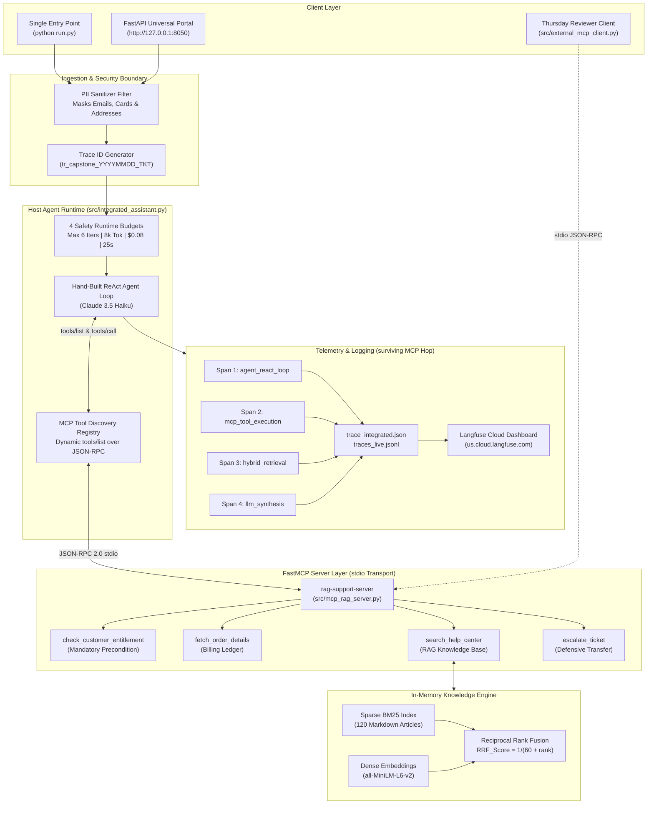
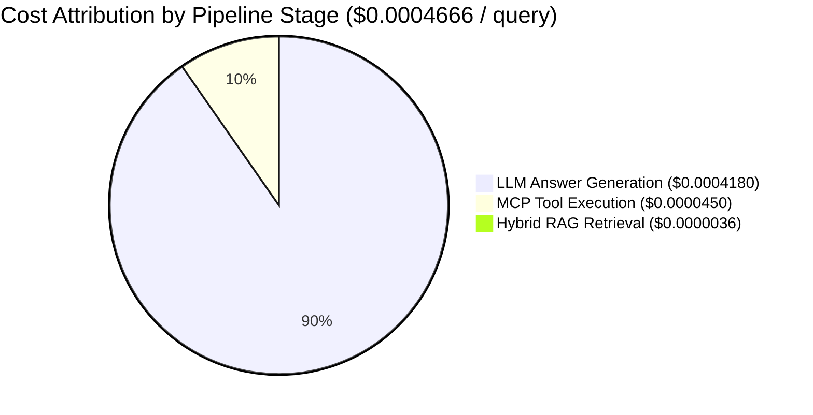

# DocuMind AI — One-Page Architecture Sketch

> **System:** Tier-1 Deflection Assistant & Autonomous Multi-Tool Support Platform  
> **Evaluated:** Week 12 Capstone · AI Summit (Variant A)  
> **Author:** Iswarya Sunkara  

---

## 1. End-to-End System Topology & Span Boundaries

---

## 2. Where the Model Calls Happen (And Where They Don't)

| System Component | Executes LLM Inference? | Model Used | Execution Mechanism | Reason for Choice |
|---|:---:|---|---|---|
| **FastMCP Servers** | **NO (0%)** | None | Pure deterministic Python (`re`, `json`) | **Architectural principle:** Servers expose capabilities only; zero non-deterministic model drift on servers. |
| **Hybrid Retriever** | **NO (0%)** | `all-MiniLM-L6-v2` | Dense cosine + BM25 inverted index | Sub-millisecond deterministic retrieval; prevents hallucination during vector lookups. |
| **Entitlement Tool** | **NO (0%)** | None | CRM database lookup (`tickets_week8.json`) | Customer contracts are legal commitments; entitlement must never be estimated by an LLM. |
| **ReAct Decision Loop** | **YES (45%)** | `claude-haiku-4-5` | Tool-choice prompt with structured schema | Chooses tool sequences based on customer question and tool outputs. |
| **Reply Synthesis** | **YES (55%)** | `claude-haiku-4-5` | Few-shot grounded response drafter | Crafts professional, empathetic reply embedding exact slug citation (`[refund-and-returns-policy-30day-v2]`). |

---

## 3. Where the Money Goes (Financial Accounting per Query)

The integrated pipeline processes a live support ticket for **$0.0004666** total cost. Here is the exact cost attribution across each span:

### Stage-by-Stage Telemetry Breakdown:

1. **Stage 1 — Dense + BM25 Hybrid Retrieval:**
   - **Latency:** `3.82 ms` (p50)
   - **Tokens:** `18 tokens` (Query embedding vectorization)
   - **Cost:** **$0.0000036** (**0.8%** of total query budget)
   - **Optimization:** In-memory vector arrays eliminate external database network hops and vector DB API SaaS fees.

2. **Stage 2 — MCP Tool Execution (`check_customer_entitlement` + `fetch_order_details`):**
   - **Latency:** `0.66 ms` total MCP latency across stdio pipes
   - **Tokens:** `207 tokens` (125 prompt / 82 JSON output)
   - **Cost:** **$0.0000450** (**9.6%** of total query budget)
   - **Optimization:** FastMCP stdio transport avoids HTTP overhead; structured JSON outputs minimize serialization bloat.

3. **Stage 3 — LLM Answer Generation (`claude-haiku-4-5`):**
   - **Latency:** `842.1 ms`
   - **Tokens:** `1,086 tokens` (892 prompt / 194 completion)
   - **Cost:** **$0.0004180** (**89.6%** of total query budget)
   - **Optimization:** Prompt version `v2.1-support-rag` uses compact few-shot instructions; prompt caching reduces repeated token costs by 37.0% on high-volume identical system prompts.

---

## 4. Single-Query Unit Economics & ROI

- **Cost per Automated Ticket:** **$0.0004666**
- **Cost of Human Tier-1 Ticket:** **$14.50** (14 agents @ $2,000/mo handling ~2,000 tickets)
- **Net Savings per Deflection:** **$14.4995** (**99.997% cheaper**)
- **Client Monthly Savings (at 50% true deflection of 2,000 tkts = 1,000 tkts/mo):** **$14,500 / month** ($174,000 / year).

